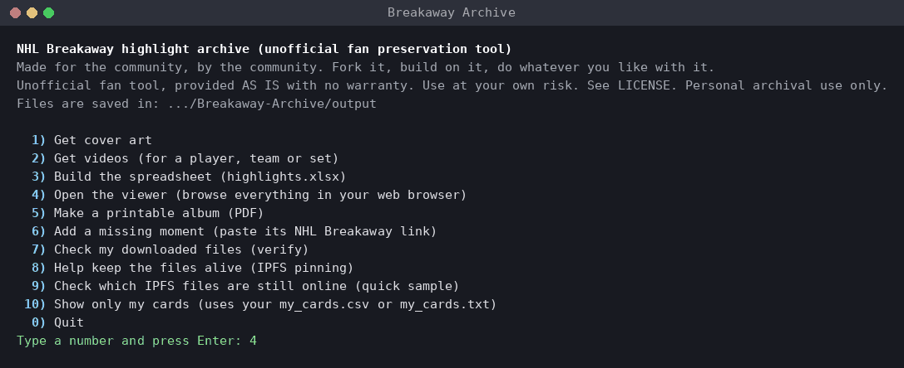
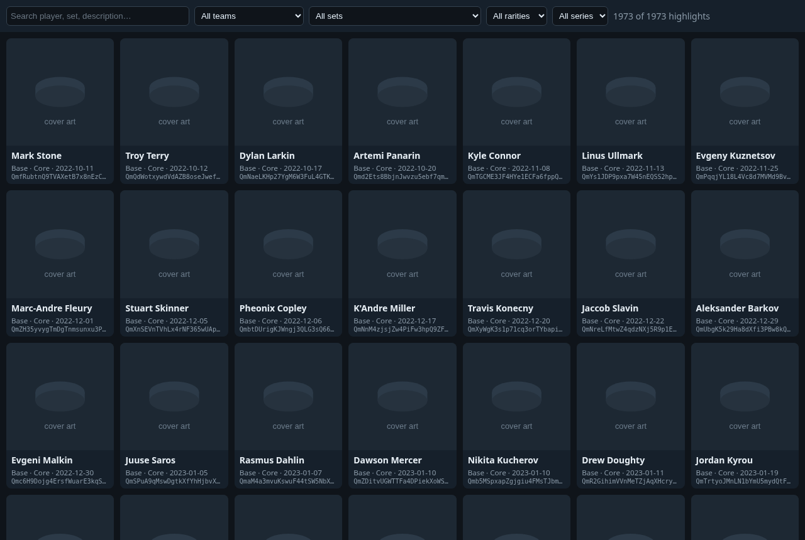

# breakaway-data

*Made for the community, by the community. Fork it, build on it, do whatever you like with it.*

## Start here

> **What you get, on your own computer:** the details of all 1,973 NHL Breakaway moments, their cover art and videos (download as many as you like), an offline viewer to browse them, a printable album (PDF) and a spreadsheet.
>
> 1. **Download the app:** https://github.com/breakaway-vault/breakaway-data/releases/latest (pick the zip for Windows, Mac or Linux).
> 2. **Unzip, double-click, type a number.**
>
> Windows may say "Windows protected your PC": click **More info**, then **Run anyway** ([why](#faq); Mac and Linux steps are [here](#no-python-download-the-app)).

### What should I pick first?

In the menu, most people want **4) Open the viewer** (browse every moment right away), **1) Get cover art** (saves all the covers to your computer) and **5) Make a printable album (PDF)**. Have your own list of cards? Pick **10) Show only my cards** ([how](#show-only-my-cards-optional)).





An unofficial fan archive of NHL Breakaway digital highlights: the details of all 1,973 known moments, saved here so they survive if the site goes away.
A small tool turns it into a spreadsheet, an offline viewer and a printable album, and downloads the original cover art and videos from IPFS.
Free to use, fork and share. Provided AS IS with no warranty ([details](#no-warranty-use-at-your-own-risk)).

**Jump to:** [Start here](#start-here) · [Download the app](#no-python-download-the-app) · [**Show only my cards**](#show-only-my-cards-optional) · [FAQ](#faq) · [With Python](#with-python-windows-mac-or-linux) · [Common tasks](#common-tasks) · [If NHL Breakaway shuts down](#if-nhl-breakaway-shuts-down) · [Help keep it alive](#help-keep-it-alive) · [No warranty](#no-warranty-use-at-your-own-risk)

## What this project is (and isn't)

It only uses public pages and links: no logins, no wallets, no personal data.

It saves a copy of what NHL Breakaway already shows to everyone, so the details survive. No highlight images or videos are stored here (only a screenshot of the viewer); the tool fetches them for your own personal archive. The technical details are in [Data sources and privacy](#data-sources-and-privacy).

## FAQ

**Is it free?** Yes. It's open source under the MIT license: no account, no payment, no ads.

**Is it safe?** All of the code is public in this repo (the tool is one file, `breakaway.py`), and the app downloads are built from it by GitHub's own build service ([`release.yml`](.github/workflows/release.yml)). The apps aren't code-signed, so Windows and Mac warn you the first time you open them; that's normal for small free tools ([what to click](#no-python-download-the-app)). The tool only reads public pages and files and needs no account or password (the optional pinning feature uses your own pinning-service token, only if you choose to pin).

**Do I need a wallet, a login or crypto?** No. There's nothing to connect, sign or pay. (The optional [Show only my cards](#show-only-my-cards-optional) export on The Fifth Line looks up your public wallet address on that site, but this tool never asks for it.)

**Where do my files go?** Into an `output` folder next to the app: covers, videos (`output/videos`), the spreadsheet and the album. The viewer is saved in a `viewer` folder and the archive data in a `data` folder, both next to the app. If that folder can't be written to, the app uses a `Breakaway-Archive` folder in your home folder instead.

**Some covers in the viewer are blank or slow to appear?** Until you download them, the viewer loads each cover live from the internet (a public IPFS link first, then NHL Breakaway's own image server if that is slow), so they can take a moment when many load at once. To make them instant (and work offline), run **1) Get cover art** first, or with **10) Show only my cards** to get just yours, then open the viewer again.

**How much space does it need?** The archive data is about 50 MB. All 1,973 covers are about 1.7 GB. All the videos together are roughly 220 GB, so most people pick a player, team or set; the app shows the size and asks before downloading any videos. A full one-PDF album is about 2.3 GB.

## Quick start

### No Python? Download the app

1. Go to the [**Releases**](https://github.com/breakaway-vault/breakaway-data/releases) page and open the newest version.
2. Download the zip for your computer: `Breakaway-Archive-windows.zip`, `Breakaway-Archive-macos.zip` or `Breakaway-Archive-linux.zip`.
3. Unzip it (Windows: right-click > **Extract All**). You get a `Breakaway-Archive` folder.
4. Double-click `breakaway` (`breakaway.exe` on Windows). A window opens with a numbered menu. Type a number and press Enter.

Everything it makes goes into an `output` folder next to the app. The first run unpacks the archive data (about 50 MB) into a `data` folder next to the app.

The apps aren't code-signed, so your computer warns you the first time:
* **Windows** shows "Windows protected your PC": click **More info**, then **Run anyway**.
* **macOS** says it "cannot be opened because the developer cannot be verified": **right-click** (or Control-click) the app, choose **Open**, then **Open** again. If there's no Open button, go to System Settings > Privacy & Security and click **Open Anyway**. The menu opens in Terminal.
* **Linux**: if double-clicking does nothing, open a terminal in the folder and run `chmod +x breakaway` and then `./breakaway`.

### Show only my cards (optional)

Want the album, viewer and downloads for **just your own cards**? It takes two steps.

The Fifth Line already lists most moments (about 1,800 of the archive's ~1,970), so its export is a quick head start, not a requirement. If a few of your cards aren't on the site, add them to the same file by hand: one new line each with the card's NHL Breakaway link or `seriesId/tokenId`. If a moment is missing from the archive itself, add it with the `add` command or a pull request (see [Contributing](CONTRIBUTING.md)).

**Step 1: get your export from The Fifth Line**
1. Open https://thefifthlinecode.onrender.com and search your wallet address. That opens your portfolio.
2. Optional: filter by player.
3. Click **Export my cards** (next to **Compress**). It downloads `my_cards.csv`.

**Step 2: use it in the tool**
1. Put `my_cards.csv` in the same folder as the app (the `Breakaway-Archive` folder), or in the repo folder next to `breakaway.py`.
2. Open the app and pick **10) Show only my cards** from the menu. With Python, add `--mine` to a command (`python breakaway.py album --mine`), or `--mine path/to/file.csv` for a file somewhere else.
3. The viewer, album, spreadsheet and downloads then show only your cards. Your edition numbers show up too: lowest first on each card ("yours #5, #17, #26 +19 more"), with the full list in the card's details, in the spreadsheet and on the album's "My serials" pages.

**Doesn't work?**
* **The file is in the wrong folder.** It must sit right next to the app (or `breakaway.py`), not in Downloads or a subfolder.
* **The file was renamed** (e.g. `my_cards (1).csv`). Rename it back to `my_cards.csv`, or point to it: `--mine "path/to/your file.csv"` (any .csv works), or type its path when the menu asks.
* **The CSV is empty** because the player filter matched nothing. Export again without the filter.
* Lines that don't match a card are listed and skipped; nothing breaks.

**No export? Do it by hand.** Make a plain text file called `my_cards.txt` in the same folder (Notepad on Windows; TextEdit on Mac, Format > Make Plain Text). Put one card per line: a card number from this archive (like `22`) or the card's NHL Breakaway link copied from your browser. `seriesId/tokenId`, `nft.nhlbreakaway.com` links and The Fifth Line card links (`.../player/22`) work too. Lines starting with `#` are ignored. If both files exist, `my_cards.txt` is used.

**Your list stays on your computer.** The tool only reads it. It is never uploaded or sent anywhere. `my_cards.csv` and `my_cards.txt` are in `.gitignore`, so they won't land on GitHub even if you fork, and so are the files made from them (`output/my_album.pdf`, `output/my_cards.xlsx`, `viewer/`). Your list doesn't need your wallet address, and no collector's wallet is stored anywhere in this repo.

<details><summary>Details for CSV files and commands</summary>

```
python breakaway.py album --mine      # output/my_album.pdf, "Owned ×22: #5, #17, #26 +19 more" on each card, full list at the end
python breakaway.py view --mine       # viewer with a "My cards" on/off switch
python breakaway.py build --mine      # output/my_cards.xlsx with a "My Editions" column
python breakaway.py covers --mine     # also: videos --mine, pin --mine
```
The Fifth Line export has the columns `card_id,url,series_id,token_id,edition,player,set`. A card is matched on `card_id` first, then `url`, then `series_id` + `token_id`, and `edition` is shown when given. Other CSVs work too if a column holds card ids or links.
</details>

### With Python (Windows, Mac or Linux)

1. Get the files, either way:
   * **git:** `git clone https://github.com/breakaway-vault/breakaway-data.git`
   * **no git:** on the GitHub page click **Code > Download ZIP** (or pick a version under **Tags**/Releases) and unzip it.
2. Install Python 3.10 or newer from https://www.python.org/downloads/ (Windows: tick **"Add Python to PATH"**). Mac and most Linux already have `python3`.
3. Open a terminal in the folder. Windows: click the File Explorer address bar, type `cmd`, press Enter. Mac: right-click the folder > New Terminal at Folder.
4. Install the three libraries once: `python -m pip install -r requirements.txt`
5. Run `python breakaway.py` with no arguments for the same menu the app shows, or use the commands below.

On Mac/Linux, type `python3` where it says `python`. On Windows, if `python` isn't found, type `py`.

## Common tasks

| I want to... | Menu | Command |
|---|---|---|
| Get the cover art (about 1.7 GB for all) | 1 | `python breakaway.py covers` |
| Save the at-risk files first | | `python breakaway.py videos --at-risk` and `covers --at-risk` (list: [`data/at_risk.md`](data/at_risk.md)) |
| Get videos for my players | 2 | `python breakaway.py videos --player "McDavid"` (also `--team`, `--set`, `--series`, `--ids 12,40`, `--limit 5`) |
| Make the spreadsheet | 3 | `python breakaway.py build` -> `output/highlights.xlsx` |
| Browse everything | 4 | `python breakaway.py view`, then double-click `viewer/index.html` |
| Make a printable album | 5 | `python breakaway.py album --team "Maple Leafs" --layout 3x3` -> `output/album.pdf` |
| Only my cards | 10 | `python breakaway.py album --mine` (see [Show only my cards](#show-only-my-cards-optional)) |
| Add a missing moment | 6 | `python breakaway.py add https://nhlbreakaway.com/series/<id>/<token>` |
| Check my downloads | 7 | `python breakaway.py verify` |
| Help keep the files online | 8 | `python breakaway.py pin` (see [Help keep it alive](#help-keep-it-alive)) |

Things to know:
* **Covers and videos come from IPFS first**, which serves the original files. Every file is checked against the sha256 fingerprint in its metadata. NHL Breakaway's own CDN is only a fallback, and it now serves *re-encoded* videos. Those are kept but marked `reencoded` in `output/download_log.json`. `verify` shows original vs. re-encoded, and `--repair` swaps re-encoded files for originals.
* **Videos are big**: all of them come to roughly 220 GB. `videos` shows an estimate and asks before downloading. Re-running resumes and skips finished files.
* **Album options**: `--layout 1up|2x2|3x3`, `--page letter|a4`, `--bleed` (3 mm bleed + crop marks for a print shop), `--max-px 600 --jpeg 80` for a small screen-only file. The full album is about 2,061 / 615 / 343 pages (1up / 2x2 / 3x3) and ~2.3 GB, so one PDF per series is easier. Each card shows its cover's IPFS CID.
* **Works offline**: once covers (and any videos) are downloaded, `build`, `view` and `album` need no internet. Add `--offline` to be sure.

## If NHL Breakaway shuts down

**Still works:** everything in this repo. `data/meta/` holds every highlight's metadata byte-for-byte as served, with every IPFS CID and sha256 for its images and video. `build`, `view` and `album` run from `data/` plus whatever you downloaded.

**Stops working:** `fetch` and `add` (they read NHL Breakaway's servers) and the CDN links in the spreadsheet.

**Rebuild from IPFS alone:**
```
python breakaway.py covers --ipfs-only
python breakaway.py videos --ipfs-only --player "Ovechkin"
python breakaway.py build && python breakaway.py view && python breakaway.py album --series "Series 1"
python breakaway.py verify
```
`--ipfs-only` never contacts NHL Breakaway. Add your own gateway first with `--gateway https://your-gateway/ipfs/` (repeatable), or set `"gateways"` in `breakaway.config.json`. Files only stay on IPFS while someone pins them, so pin what you care about now (next section). `data/ipfs_status.json` shows how many were still reachable at the last check.

## Help keep it alive

Nothing is pinned by this project. The originals survive only if people keep copies:
1. **Keep the folder.** Back up `data/` (the archive) and `output/` (your downloaded covers and videos).
2. **Pin the CIDs.** `python breakaway.py pin` writes CID lists to `output/pin/` (`all.txt`, `video.txt`, `cover.txt`, ...). Then either:
   * your own IPFS node ([Kubo](https://docs.ipfs.tech/install/command-line/)): `python breakaway.py pin --kubo --types video,cover --series "Series 1"`
   * a pinning service with your own API token (it's read from the environment and never saved):
     `PIN_SERVICE_TOKEN=... python breakaway.py pin --service pinata --types cover` (or `--service filebase`, or any [IPFS Pinning Service API](https://ipfs.github.io/pinning-services-api-spec/) URL). On Windows: `set PIN_SERVICE_TOKEN=...` first.
   Pinning resumes where it stopped (`output/pin/pinned_*.txt`).
3. **Verify** now and then: `python breakaway.py verify`.
4. **Check availability**: `python breakaway.py check-ipfs` checks a sample (200 by default) and writes `data/ipfs_status.json`. `--full` checks all 14,739 CIDs, which takes hours. "Not reachable" can also mean no gateway had it cached at that moment, so treat those as at risk rather than lost.

## No warranty, use at your own risk

This tool and data are provided **AS IS, with no warranty of any kind**, express or implied ([MIT License](LICENSE)).
* The maintainers and contributors **aren't liable for anything that happens from using it**: data loss, corrupted or incomplete downloads, disk space, bandwidth or data-plan costs, account problems, or any consequences under the terms of service of NHL Breakaway, Sweet or any other site.
* **You're responsible** for how you use it, and for following those sites' terms and your local laws.
* There's **no guarantee** that the data is complete or accurate, or that any file stays available.
* It's for **personal archival use**. Don't repost the images or videos.
* **Please be gentle with other people's servers.** Keep the default throttling, download only what you need, and don't run many copies at once.
* No affiliation or endorsement (see the disclaimer below).

## Disclaimer

Unofficial fan preservation project. Not affiliated with or endorsed by the NHL, NHLPA, NHLAA, Sweet (SocialSweet Inc.) or any team. All trademarks, names, logos, videos and images belong to their respective owners. This repository contains no highlight media (apart from one screenshot of the viewer); anyone who downloads media with the tool does so only for personal archival use. Takedown requests are honored: please open a [GitHub issue](https://github.com/breakaway-vault/breakaway-data/issues).

Card list originally compiled from The Fifth Line (https://thefifthlinecode.onrender.com).

---

## Reference

### Data sources and privacy

It catalogs **public data**: the NFT metadata and public set and listing data that NHL Breakaway and Sweet already publish for anyone to see.
* **Public, unauthenticated endpoints only:** `nft.nhlbreakaway.com`, `apigw.sweet.io` (set listings), NHL Breakaway's media CDN and public IPFS gateways. No logins, cookies, paywalls or private APIs, and nothing that gets around rate limits or access controls (it slows down on 429s and stops on 401/403). The only credential the tool ever touches is your *own* pinning-service token, and only if you choose to pin.
* **No personal data:** no owner or collector names, usernames, wallets, emails or account data are stored. The one wallet address in the raw metadata is Sweet's own royalty-fee address (`fees.recipient_address`), which is part of every token's public metadata. `status` records only *that* a listing or price was seen, never who.
* **No media in the repo:** no highlight images or videos are hosted here, apart from one small screenshot of the viewer in `docs/images/`. They stay the property of their rights holders. The tool only helps individuals fetch the public files for their own personal archival use.

### What's in the repo

| Path | What it is |
|---|---|
| `data/highlights.json` | The card list. Fields: card `id`, player, set, rarity, edition size, team, an October 2026 price snapshot (lowest ask / FMV, empty for later additions), `on_site` (false for the 162 moments found later in NHL Breakaway's set listings), `site_url` (original 1,811 only) and `status`. Ids 1-1818 come from the original list; added moments get the next free numbers. |
| `data/meta/<id>.json` | Raw `https://nft.nhlbreakaway.com/series/<series>/<token>` response per highlight, byte-for-byte. |
| `data/manifest.json` | Per highlight: source URL, fetch time (UTC), sha256 of the stored file, moment UUID, how it was linked, and every IPFS CID + sha256 in its metadata. |
| `data/offchain/` | Raw NHL Breakaway set listings, set-completion and quest data. |
| `data/links.json` | Card id -> series id + token id (+ moment UUID). |
| `data/cids.txt` | Every IPFS CID (14,739), deduplicated. |
| `data/ipfs_status.json` | Last `check-ipfs` result per CID (reachable / uncached / gone, by file type). |
| `data/live_status.json` | Last `check-live` result per moment (still listed? CDN cover/video status). |
| `data/at_risk.md` | Moments whose original files are missing on IPFS. |
| `data/extra_moments.txt` | Links to add (anyone can edit; see CONTRIBUTING). |
| `breakaway.py` | The whole tool (one file). |
| `scripts/validate.py`, `scripts/build_app.py` | CI checks; standalone-app build (PyInstaller). |

### `status`, `listed_now`, `ipfs_health`

`status`:
* `released`: there's evidence the moment was actually sold or held, either a live marketplace listing seen in October 2026 (32 of the later additions) or a price in the original card list (1,663).
* `unverified`: no such evidence was found. It may still be real; it just hasn't been confirmed. It doesn't mean fake. No owner names are recorded.
* `delisted`: the moment no longer appears in NHL Breakaway's current public set listings. All of its data is kept, and the earlier value is kept in `status_before_delisting`.

`listed_now` (true/false): whether the moment's UUID is in the current `apigw.sweet.io` set listing at the last `python breakaway.py check-live`. That command also does a 1-byte request for each cover and video on the CDN and records the HTTP status in `data/live_status.json` (`cdn_cover`, `cdn_video`; 200/206 = still served). The raw `data/offchain/` files are never overwritten, so the data as first archived stays.

`ipfs_health`, from the last `check-ipfs` (the full scan plus `--recheck`):
* `all_ok`: every checked original file of the moment answered on IPFS (small thumbnails are ignored while they are unchecked).
* `some_missing`: at least one file (not the video) didn't answer; `ipfs_missing` lists which.
* `video_missing`: the original video didn't answer.
* `all_missing`: none of its files answered.
* `unchecked`: not checked yet.

"Missing" means no gateway we asked could serve it, on two passes and at least two gateways. It may be unpinned or just very cold: it's at risk, not proven lost. `data/ipfs_status.json` has the per-file `verdict`: `reachable`, `uncached` (failed once, answered on retry) or `gone` (failed both passes). **`data/at_risk.md`** lists every moment with missing files and whether the CDN still has them. Save those first with `covers --at-risk` and `videos --at-risk`.

### All commands

```
python breakaway.py                         # menu
python breakaway.py fetch   [--refresh] [--ids 12,40] [--discover [--limit N]]
python breakaway.py covers  [filters] [--repair] [--ipfs-only | --cdn-first]
python breakaway.py videos  [filters] [--video-dir DIR] [--limit N] [--yes] [--repair] [--ipfs-only]
python breakaway.py build | package | all | view [--viewer-dir DIR]
python breakaway.py verify  [--video-dir DIR]
python breakaway.py add     <url | seriesId/tokenId> ...      # also reads data/extra_moments.txt
python breakaway.py album   [filters] [--layout 1up|2x2|3x3] [--page letter|a4] [--bleed] [--out FILE] [--max-px N] [--jpeg Q]
python breakaway.py check-ipfs [--sample 200 | --full | --recheck] [--refresh] [--max-age DAYS] [--seed N]
python breakaway.py check-live  [--no-cdn]                   # still in the current set listings? CDN still serving?
python breakaway.py health                                   # recompute ipfs_health / at_risk.md from the saved results
python breakaway.py pin     [filters] [--types video,cover] [--kubo | --service pinata|filebase|URL] [--limit N] [--yes]
filters: --player, --team, --set, --series, --ids (names match partially, not case sensitive),
         --at-risk (only moments whose originals are missing on IPFS; for videos/covers: that file is missing)
general: --output-dir DIR, --offline, --config FILE, --gateway URL, --concurrency N (metadata, 1-8),
         --media-concurrency N (downloads, 1-4), --ipfs-concurrency N (check-ipfs, 1-4)
```

**Settings file:** copy `breakaway.config.example.json` to `breakaway.config.json` (next to `breakaway.py` or the app) to set the gateways, concurrency, output/video/viewer folders, `ipfs_only`, `offline` or the issues link for your fork. Flags always win. Nothing in the code depends on this repo's location, so forks work as-is.

**Politeness:** every host gets its own throttle, requests back off on errors, `Retry-After` on 429 is respected, and a gateway that answers 429 is rested for a while. 401/403/404 are never worked around.

### The spreadsheet

* **Highlights**: one row per highlight with a cover thumbnail, player, team, date, play, game details, set, series, rarity, edition size, status, description, price snapshot, links, and the cover / video / card-image IPFS CIDs + sha256.
* **All Metadata**: every field of every stored metadata file, flattened.
* **IPFS**: every CID and sha256 per highlight.
* **By Set**: counts.

### Contributing

See [CONTRIBUTING.md](CONTRIBUTING.md): fork, add the link to `data/extra_moments.txt` (or run `add`), open a pull request. CI validates it. Or open a **Missing moment** issue. Changes are listed in [CHANGELOG.md](CHANGELOG.md).

### License

Code: MIT ([LICENSE](LICENSE)). The metadata in `data/` is a preservation copy of public NHL Breakaway / Sweet metadata. It and all highlight media, names and marks remain the property of their rights holders (NHL, NHLPA, NHLAA, SocialSweet Inc.). No highlight media is stored in this repo, apart from one screenshot of the viewer.
